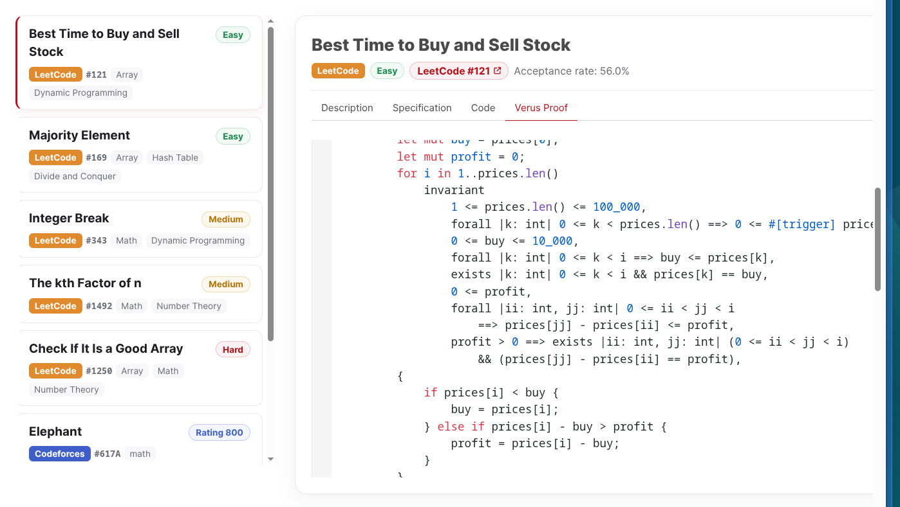
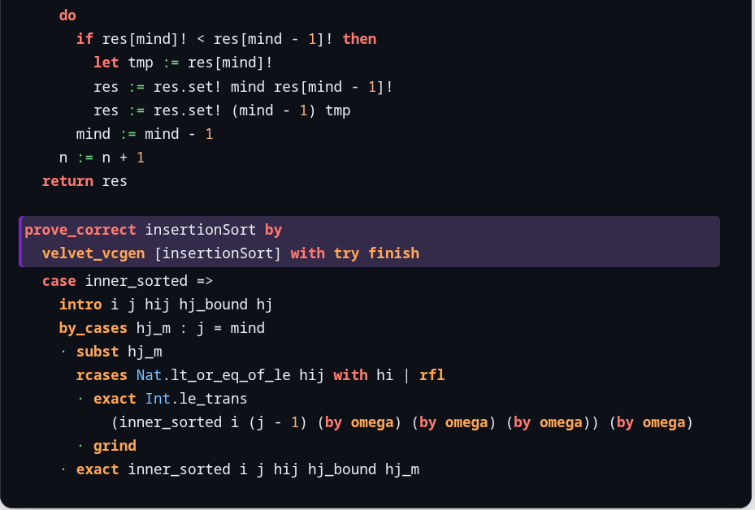

---
title:
- "Warsaw Lean 4 users: intro"
author:
- Paweł Balawender
date:
- Tuesday, 27th of October, 2026
# pandoc -t beamer --slide-level=2 presentation.md -o presentation.pdf --bibliography references.bib --citeproc  -M link-citations=true -V colortheme:crane -V theme:CambridgeUS --csl apa.csl
---

# Plan
- Intro + organisation
- What was happening in summer?
- What is happening next month?
- Direction 1: AI4Math
- Direction 2: Software verification

# Intro + organization
## Key info

- Website with announcements: https://warsaw-lean4-users.github.io/
- GitHub org: https://github.com/warsaw-lean4-users
- Meetings: monthly. Probable next (approximate):
    - 24th of November
    - then 15th of December.
- Communication: Lean Zulip: Warsaw location topic.
- We're not a "koło naukowe" yet
- We don't have pizza sponsorship yet

## Goal of the meetings
- **Help each other start and finish projects centered around verification, by:**
    - staying up to date with ongoing events, announcements
    - feedback for project ideas
    - creating space for people of different backgrounds to learn about verification

- This talk will mostly be a recap of what was/is happening. Future talks are free to have different format

## My calendar project
- I've gathered all the events that were at least remotely interesting
- Some focus on student stuff, including mentorships and volunteering opportunities
- Please check out! Even small contributions are welcome :)
- https://ruplet.com/ai4math-calendar

# Recap of last months: general events

## June, July (selected)

- 29 June--3 July: [ECOOP 2026](https://2026.ecoop.org/) - Brussels; including [UNSOUND](https://2026.ecoop.org/home/unsound-2026)
- 11 July: AI4Math workshop at ICML 2026
- 13--29 July: Federated Logic Conference (FLoC 2026), Lisbon, including:
    - Conference on Interactive Theorem Proving (ITP)
    - Conference on Computer Aided Verification (CAV)
    - Conference on Automated Reasoning (IJCAR)
    - Symposium on Logic in Computer Science (LICS)
    - Computer Security Foundations Symposium (CSF)
    - competitions for SAT, SMT and QBF solvers
- FLoC is once every 4 yers! Next one in 2030

## August, September (selected)
- 24–29 August [ICFP 2026 + affiliated events](https://icfp26.sigplan.org/)
- 7--11 September: [Proof Society 2026](https://proofsociety26.sciencesconf.org/)
- 15--18 September: [FMCAD 2026](https://fmcad.org/FMCAD26/program/)
- 21–25 September: [CICM 2026](https://cicm-conference.org/2026/cicm.php)
- 4–9 October: [SPLASH 2026](https://2026.splashcon.org/)

- Full calendar: https://ruplet.com/ai4math-calendar

## Zulip statistics
17 953 total users. Only 1671 users active in the last 15 days.

\begin{center}
\includegraphics[width=0.94\textwidth,height=0.49\textheight,keepaspectratio]{assets/zulip-total-users-all-time.pdf}
\end{center}

Source: https://leanprover.zulipchat.com/stats

## What was talked about on Zulip?

- 1. (1718 messahes, 272 reactions) [Physlib: Yukawa sector of the Standard Model](https://leanprover.zulipchat.com/#narrow/channel/479953-Physlib/topic/Project%3A%20Formalising%20the%20Yukawa%20sector%20of%20the%20Standard%20Model/near/630990313)
- 2. (264 messages, 724 reactions) [Counterexample to the Collatz Conjecture: soundness bug](https://leanprover.zulipchat.com/#narrow/channel/270676-lean4/topic/Counterexample%20to%20the%20Lean%20Conjecture%20%28Soundness%20Bug%29/near/620332700).
- 3. (195 messages, 708 reactions) Anthropic's FLT formalization (will discuss later)

# What is happening this and next month?
## October

- 26–-30 Oct: [Bristol Lean week](https://bristol-lean.github.io/blue/events/)
- 24–-29 Oct: [EMNLP 2026](https://2026.emnlp.org/): Budapest.
- 31 Oct: ELLIS applications are closing for PhD students
- 31 Oct: Mathlib reviewer bootcamp application is closing

## November

- 6 Nov: [EACL ’27 Student Research Workshop](https://2027.eacl.org/calls/srw/) (student research paper / phd thesis feedback)
- 7 Nov: Conference on Software Verification in Lean [SVIL '26 Fall](https://beneficial-ai-foundation.github.io/SVIL2026_Fall/#registration) - can join online to watch streams
- 11 Nov: [POPL ’27 student volunteers](https://popl27.sigplan.org/track/POPL-2027-student-volunteers): registration + meals; travel / lodging excluded. [Zulip call](https://leanprover.zulipchat.com/#narrow/channel/579629-Event-announcements/topic/POPL27.3A.20Call.20for.20Student.20Volunteers/with/630961882).
- 16 Nov: [NAACL ’27 Student Research Workshop](https://2027.naacl.org/calls/srw/)
- 30 Nov: [AAAI ’27 scholar / volunteer applications opens](https://aaai.org/conference/aaai/aaai-27/student-scholar-volunteer-program/)

# AI4Math

## Discussion of OpenAI: Navier–Stokes + the massive GitHub dump

- 8 September: [Navier Stokes annonuncement](https://openai.com/index/navier-stokes-solution/); [paper](https://cdn.openai.com/pdf/32d9f210-8b73-45e0-91bc-82a30aef8a9a/navier-stokes.pdf); [Lean dump](https://github.com/openai/NavierStokesAndEuler).
- 6 October: [Navier–Stokes lost in translation, arXiv:2610.08144](https://arxiv.org/abs/2610.08144): paper / Lean mismatch; $m+4$ vs. $m+5$ derivatives. No claim that the written proof is incorrect.
- [Lean Zulip discussion](https://leanprover.zulipchat.com/#narrow/channel/113488-general/topic/Lean.20in.20the.20wild.3A.20Navier-Stokes.20proved/near/629885972)
- 6 October: [OpenAI GitHub dump](https://openai.com/index/sharing-ai-progress-in-mathematics/)
- 16 October: [How to Formalize All of Mathematics; post by Jeremy Avigad, Kevin Buzzard, Johan Commelin, Rémy Degenne, Kim Morrison, Oliver Nash and Adam Topaz](https://xenaproject.wordpress.com/2026/10/16/how-to-formalize-all-of-mathematics/)

## Anthropic + community responses

- 4 September: Anthropic's Fermat's Last Theorem formalization
- 4 September: [Kevin Buzzard's comment](https://xenaproject.wordpress.com/2026/09/04/flt-anthropic-has-beaten-me-to-it/)

Kevin Buzzard's FLT project continues. Their goal is to produce mathlib contributions + a human-readable modern proof

## AI4Math funding: Polish project with Renaissaince Philantropy grant

- Renaissance Philantropy is a major grant-given in the field of AI4Math
- This year, a Polish team lead by Bartosz Naskręcki (UAM / PW) received one of the grants
- Congratulations!
- links: [Award list](https://www.renaissancephilanthropy.org/ai-for-math-fund-2026-projects), [Agentic Approach to Computer Algebra Systems](https://www.renaissancephilanthropy.org/agentic-approach-to-computer-algebra-systems)
<!-- - [Simons: targeted grants to Math+AI institutes, 2027](https://www.simonsfoundation.org/funding/targeted-grants-to-mathai-institutes-2027/). -->

# Software verification

## Verification of imperative programs
- Until recently, state of the art was using Why3 or Dafny
- Dafny's SMT solvers tend to get stuck; not a production-ready tool
- there was a proof mode proposal for Dafny ([link](https://profs.info.uaic.ro/stefan.ciobaca/aipmda.html)) with Amazon Research funding, but it seems to not be there yet

- important well-established project: Aeneas (verifying Rust using Lean 4); ICFP 2022

## Verus
- At NeurIPS 2026, VeriContest will be presented: benchmark for solving LeetCode problems in Rust **with correctness proof in Verus** (Verus is a tool from around 2024)
- Looks good ([link](https://hiprel-group.github.io/VeriContest/about.html))

## Verifying Rust standard library
- in May 2026, NASA Formal Methods Symposium (NFM 2026) took place, and the paper "Verifying the Rust Standard Library" was published [link](https://arxiv.org/pdf/2606.17374)
- they accept many tools as verification, including Verus
- FMCAD 2026: a few talks about verifying real Rust; 18 September "Verifying a Memory Allocator for Rust"

## Signal Shot
- April 20, 2026 at SVIL workshop in Paris
- verification of the whole Signal communicator app + the protocol
- https://www.beneficialaifoundation.org/signal-shot
- supported by Beneficial AI Foundation - hint towards financing from AI Safety direction 
- other AI Safety grant-giver worth mentioning: Coefficient Giving [link](https://coefficientgiving.org/apply-for-funding/)

## Velvet
- CAV, July 2026: "Velvet: A Foundational Multi-Modal Verifier for Imperative Programs in Lean"
- https://velvetprover.dev/

## Cryptography
- CSF 2026 (part of FLoC): Dziembowski, Fabiański, Micciancio, Stefański, [Computationally-Sound Symbolic Cryptography in Lean](https://eprint.iacr.org/2025/1700)
- and more works by Warsaw crypto group - but IMO it's worth dedicating a separate meeting for their works

## Cybersecurity: HORIZON-ECCC call
- there was a call that could fund some formal verification "Security testing methodologies, including formal verification approaches and AI-driven security testing methodologies;"
- call by European Cybersecurity Centre, ECCC
- closed on September 15, but it suggests that cybersecurity-related funding is possible
- [link](https://cybersecurity-centre.europa.eu/funding-opportunities/calls-proposals/cybersecurity-horizon-cl3-2026-02-cs-eccc_en)

## Cybersecurity: ECCC-CYBERAI call (CPPC)
- there is an open call, but further from formal verification (until 14 January 2027)
- "Cybersecure tools, technologies and services relying on AI"
- https://www.gov.pl/web/cppc/nabory-2026-z-obszaru-cyberbezpieczenstwo

## FIRST TEAM FENG
- until 20 November, FIRST TEAM FENG is open (FNP)
- the call looks very broad - perhaps someone knows more about this program?

<!-- removed

People / teaching / local groups
FORM centre: https://www.linkedin.com/company/form-centre/home/

Reading / next talks
Fabrizio Montesi's blog: https://www.fabriziomontesi.com/
Software Verification in Lean 2026, Paris (April 2026), videos:
https://www.youtube.com/playlist?list=PLtlBXrgM1AlOg-jxchcgkLfTdwZWm-oN3
Swarat Chaudhuri, June 2026 / Science: https://arxiv.org/abs/2605.22763

Other Lean projects
Hex: verified computer algebra.
-->
